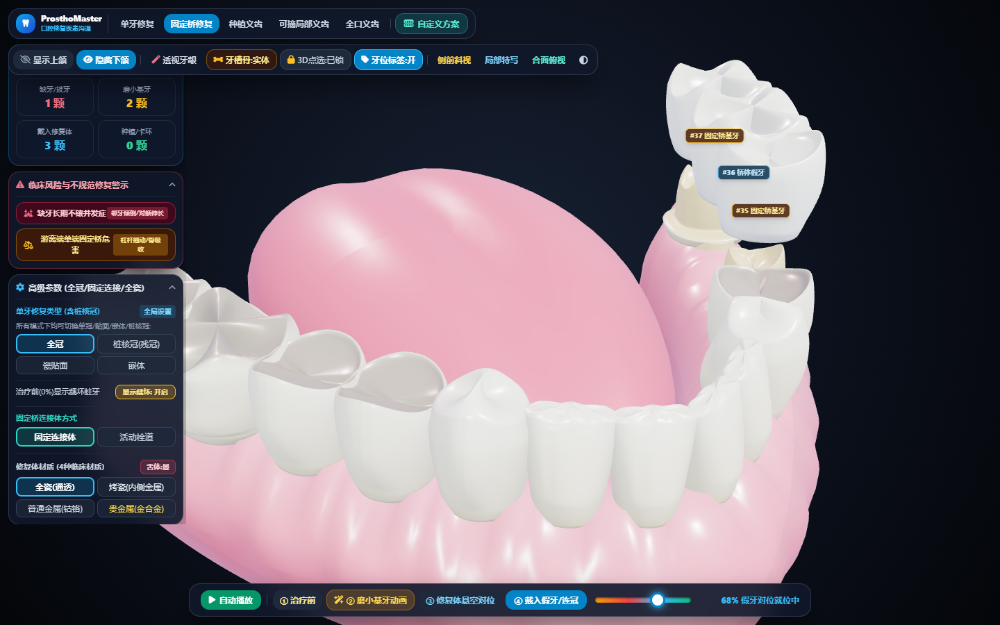
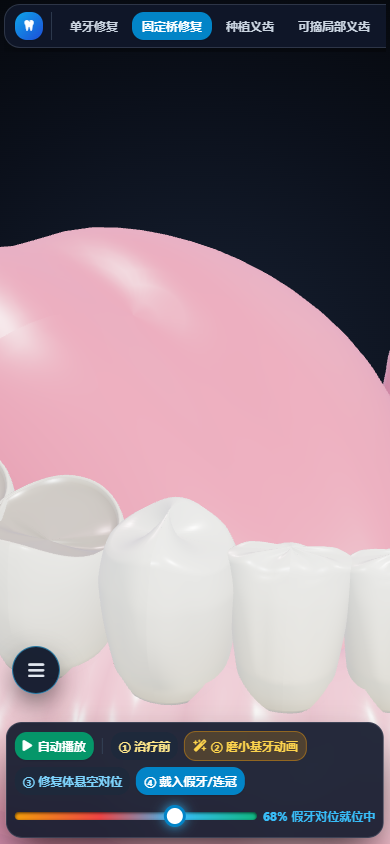

# ProsthoMaster 3D Pro · 口腔修复临床可视化系统

> 一款**打开浏览器就能用**的 3D 口腔修复演示 / 医患沟通 / 教学工具。
> 单文件、可离线、支持手机，专为诊室与医院电脑环境设计。



---

## ⬇️ 直接使用：只需要下载 1 个文件

**普通使用者只需下载 [`prosthoviz_offline.html`](prosthoviz_offline.html) 这一个文件即可。**

1. 在本仓库中点击 `prosthoviz_offline.html`；
2. 点击文件页面右上角的 **`Download raw file`（下载原始文件）** 按钮；
   （或者直接点仓库右上角 `Code → Download ZIP`，下载后解压，只留这一个文件也行）
3. 双击该文件，用 **Chrome / Edge** 打开，即开即用。

- ✅ 无需联网（所有依赖已内嵌进这一个文件）
- ✅ 无需安装软件、无需服务器
- ✅ 直接双击就能用，可发给同事、拷到 U 盘、放到院内共享盘

> 建议把文件重命名为更好记的名字，例如 `口腔修复可视化.html`。

---

## 📱 手机端如何打开

### 方式一：在线打开（推荐，最方便分享）

开启 GitHub Pages 后，用手机浏览器访问即可，无需下载：

1. 本仓库 → `Settings` → 左侧 `Pages`；
2. `Source` 选择 `Deploy from a branch` → `Branch` 选 `main`、目录选 `/ (root)` → `Save`；
3. 等 1 分钟后，手机浏览器打开：

   ```
   https://<你的用户名>.github.io/<仓库名>/prosthoviz_offline.html
   ```

（把它发到微信里，别人点开就能看。）

### 方式二：下载到手机本地打开（无网也能用）

- **安卓**：用浏览器下载该 HTML 文件 → 在「文件管理」里找到它 → 选择「用浏览器打开」。
- **iPhone / iPad**：用「文件」App 打开下载好的 HTML → 右上角分享 → 用 **Chrome** 打开；
  或使用 Safari 打开本地文件（部分 iOS 版本需借助「文件」App 的分享菜单）。

### 手机端操作说明

| 操作 | 说明 |
|---|---|
| **☰ 按钮**（左下角） | 展开 / 收起左侧功能面板（抽屉式，不遮挡 3D） |
| **顶部工具栏** | 左右滑动可看到全部模式与视图按钮 |
| **单指拖动** | 旋转 3D 牙齿 |
| **双指捏合** | 缩放（放大 / 缩小） |
| **底部时间轴** | 播放四阶段动画 |
| **横屏** | 推荐，3D 演示视野更大 |



---

## ✨ 功能特色

### 🦷 六大修复模式
- **单牙修复**：全冠 / 桩核冠（残冠）/ 瓷贴面 / 嵌体
- **固定桥修复**：固定连接体 / 活动栓道
- **种植义齿**
- **可摘局部义齿**：三臂卡环
- **全口义齿**
- **自定义方案**：自由编辑

### ⚠️ 临床风险与不规范修复警示（医患沟通重点）
- **缺牙长期不镶并发症**：邻牙倾倒、对颌牙伸长、牙槽骨废用性吸收
- **游离端单端固定桥危害**：远中悬臂杠杆力矩 → 基牙倾斜、牙周创伤、骨吸收、松动

### 🎬 四阶段临床时间轴动画
> ① 治疗前（显示龋坏）→ ② 磨小基牙 → ③ 修复体悬空对位 → ④ 戴入牙冠
- 支持**一键自动播放**，也可拖动时间轴任意查看

### 🖱️ 3D 交互与显示
- 旋转 / 缩放；**侧前斜视、局部特写、合面俯视**一键切换
- **透视牙龈**、**透视牙槽骨**（X 光效果），观察牙根、种植体与骨吸收
- 上颌 / 下颌显示切换、舌体显示、龋坏显示
- 3D 牙齿上方悬浮显示 **FDI 牙位与临床标注**
- **3D 点选防误触锁定**（旋转时不会误改牙位）

### 🛠️ 自定义方案
- **FDI 牙位图点选**，或直接在 **3D 牙齿上点击**修改
- 画笔：基牙 / 桥体 / 种植 / 活动牙 / 卡环 / 待拔除 / 单纯缺牙 / 完好真牙
- **一键预设**：单冠、桩核冠、后牙桥、长桥、上前牙桥、单颗种植、可摘局部、全口义齿
- 方案**保存**、**导出 / 导入 `.json`**，方便分享给其他医生

### 🎨 材质与统计
- 4 种修复体材质：**全瓷 / 烤瓷 / 钴铬 / 贵金属**
- 修复颗数统计（缺牙、磨小基牙、戴入修复体、种植/卡环）

### 💻 跨平台
- 电脑 / 手机 / 平板均可使用；**单文件、可离线**

---

## 🛠️ 如何自己修改 / 二次开发

### 需要改的文件
- 要修改界面、文字、功能，请编辑 **源码 `prosthoviz.html`**。
- **不要直接改 `prosthoviz_offline.html`**，它是由源码自动生成的，重新打包会被覆盖。

### 修改步骤
1. 用任意文本编辑器（VS Code / Notepad++ / 记事本）打开 `prosthoviz.html`；
2. 修改内容（见下方常见修改点）；
3. 在本目录打开终端，执行打包命令，重新生成离线版：

   ```bash
   node build-offline.mjs
   ```

   （需要安装 [Node.js](https://nodejs.org/) 18+；**打包这台电脑需要联网一次**用于编译，生成的文件本身无需联网。）

4. 用新的 `prosthoviz_offline.html` 覆盖旧的即可。

### 常见修改点

| 想改什么 | 怎么做 |
|---|---|
| 浏览器标签标题 | 搜索 `<title>` 修改 |
| 页面里的任意文字 / 按钮名 | 直接搜索该文字（如「自定义方案」）并修改 |
| 默认打开的模式 | 搜索 `let currentMainMode = 'bridge';` 改成 `'single'`、`'implant'` 等 |
| 颜色 / 主题 | 界面用 Tailwind CSS 类名控制，如 `bg-sky-600`（天蓝）、`text-amber-400`（琥珀色），改成同族的其他色号即可 |
| 新增牙位 / 修复方式 | 参考 `selectMainMode`、`styleMap`、`applyPreset` 等函数 |
| 手机断点 | 搜索 `@media (max-width: 900px)`，即手机端适配层 |

### 项目结构

```
.
├── prosthoviz_offline.html   ← 成品：单文件、离线、给用户下载的就是它
├── prosthoviz.html           ← 源码：开发修改请改这个（在线用 CDN）
├── build-offline.mjs         ← 打包脚本：源码 → 离线单文件
├── tailwind.config.cjs       ← 打包用 Tailwind 配置
├── tailwind.input.css        ← 打包用 Tailwind 入口
├── vendor/                   ← 打包缓存的第三方依赖
├── docs/                     ← README 用的预览图
└── README.md
```

### 离线打包原理
打包脚本会把源码里所有外链替换为内嵌内容，因此最终文件断网可用：

| 原本依赖 | 打包后 |
|---|---|
| Tailwind CSS（CDN） | 预编译为静态 CSS 内嵌 |
| three.js r128（CDN） | 内嵌 `<script>` |
| Font Awesome 图标（CDN） | CSS + 用到的字体以 base64 内嵌 |
| Google Fonts（Inter / 思源） | 移除，改为系统字体（Windows 自动用微软雅黑） |

---

## ⚖️ 第三方依赖与许可

本项目使用了以下开源项目，其版权归各自作者所有：

- [three.js](https://threejs.org/) — MIT License
- [Tailwind CSS](https://tailwindcss.com/) — MIT License
- [Font Awesome Free](https://fontawesome.com/) — 图标 CC BY 4.0、代码 MIT License

本仓库自身代码以 [MIT License](LICENSE) 发布（请把 `LICENSE` 中的版权人改成你自己的名字或组织）。

---

## ❓ 常见问题

**Q：双击后白屏怎么办？**
A：请用 **Chrome / Edge** 打开（不支持 IE）；并确认下载的是 `prosthoviz_offline.html`，不要错误地打开了源码 `prosthoviz.html`（源码需要联网加载 CDN）。

**Q：保存的自定义方案会丢吗？**
A：方案保存在浏览器本地存储（localStorage）。**换电脑 / 换浏览器 / 清理浏览器数据都会丢失**，建议用页面内的「导出方案文件」保存为 `.json` 备份，换机后「导入他人方案」即可。

**Q：怎么把方案发给别的医生？**
A：页面内「导出方案文件」生成 `.json` 发给对方，对方「导入他人方案」即可。程序本体直接发 `prosthoviz_offline.html`。

**Q：手机上文字小 / 按钮难点？**
A：顶部工具栏可左右滑动，时间轴按钮已加大。建议手机**横屏**使用，或使用平板。

**Q：医院电脑安全策略不允许打开 HTML？**
A：可请信息科协助放行，或把该文件放到院内静态服务器 / GitHub Pages 上，用浏览器访问。

**Q：需要联网吗？**
A：下载好的 `prosthoviz_offline.html` **完全离线运行**，不向任何服务器发送数据，也不含任何真实患者信息。
